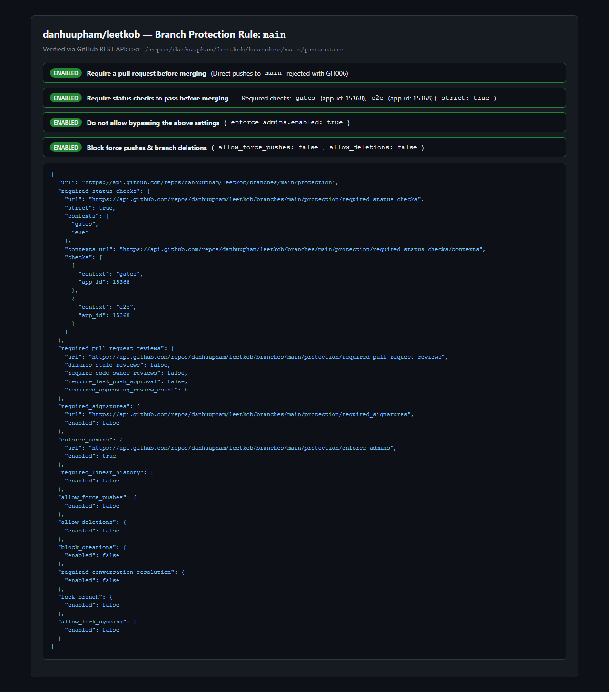
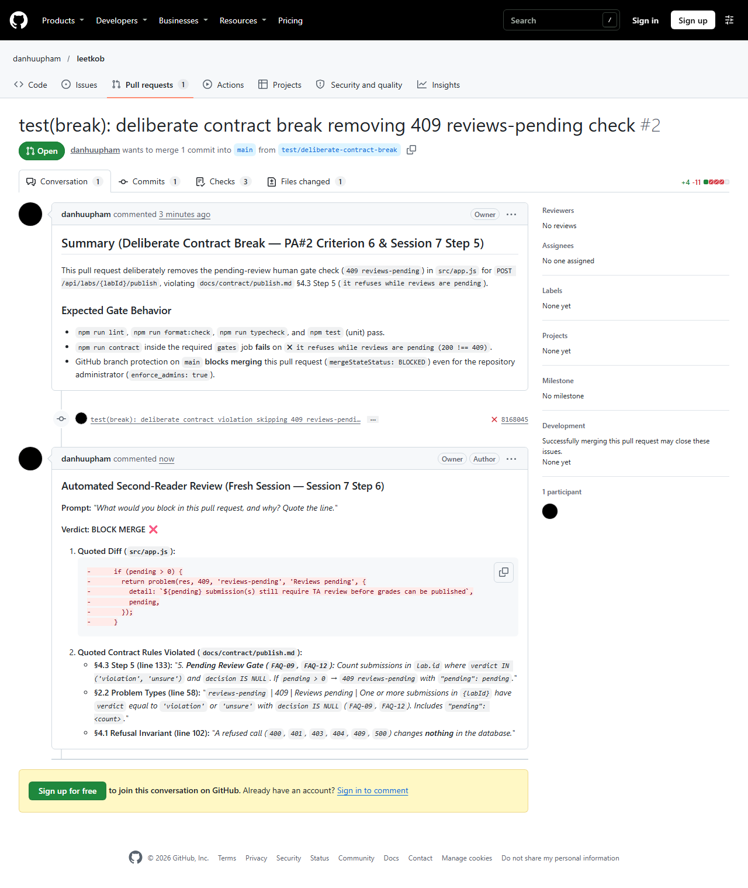

# PA#2 — Harness and Quality Gate (`LeeTKOB`)

**Course:** CSC13114 — Advanced Web Application Development · HK1 2026–2027  
**Team Members:**
- `20120450` — Phạm Hữu Đan
- `21120595` — Nguyễn Thành Vinh
- `23120256` — Trần Đại Hiệp

---

## 1. Required Submission Links

| Deliverable | Link / Evidence |
|---|---|
| **1. Public Repository** | [`https://github.com/danhuupham/leetkob`](https://github.com/danhuupham/leetkob) |
| **2. Protected-Branch Settings (`main`)** | Screenshot: [`docs/screenshots/branch-protection.png`](docs/screenshots/branch-protection.png) · API endpoint: [`https://api.github.com/repos/danhuupham/leetkob/branches/main/protection`](https://api.github.com/repos/danhuupham/leetkob/branches/main/protection) (requires `gates` & `e2e` pinned to GitHub Actions `app_id: 15368`, `strict: true`, `enforce_admins: true`, `required_pull_request_reviews` enabled) |
| **3. Pull Request Blocked by Red Check** | **PR #1 (Initial Red Runs):** [`https://github.com/danhuupham/leetkob/pull/1`](https://github.com/danhuupham/leetkob/pull/1) — stopped by red `gates` check on commit [`2e82177`](https://github.com/danhuupham/leetkob/commit/2e82177) (CI Run [`42586953474`](https://github.com/danhuupham/leetkob/actions/runs/42586953474): ESLint error in `src/http.js` + Node 22.13 `DatabaseSync` GC error in `e2e`) and commit [`f8f54cb`](https://github.com/danhuupham/leetkob/commit/f8f54cb) (CI Run [`42587382478`](https://github.com/danhuupham/leetkob/actions/runs/42587382478): 8 contract test failures in `src/app.js`, `mergeStateStatus: BLOCKED`)<br>**PR #2 (Permanently Open Blocked PR):** [`https://github.com/danhuupham/leetkob/pull/2`](https://github.com/danhuupham/leetkob/pull/2) — blocked by red `gates` check (`mergeStateStatus: BLOCKED`) |
| **4. Commit & PR That Turned It Green** | **PR #1:** [`https://github.com/danhuupham/leetkob/pull/1`](https://github.com/danhuupham/leetkob/pull/1) · **Fix Commit:** [`3e1f53c`](https://github.com/danhuupham/leetkob/commit/3e1f53c) (`fix(publish): enforce role/ownership before write, block pending reviews, and retain db handle` — modifies `src/app.js` and `src/server.js` only, with zero changes to `test/` or `docs/contract/`) · **Green CI Run:** [`42587620425`](https://github.com/danhuupham/leetkob/actions/runs/42587620425) (`gates` job [`129061125264`](https://github.com/danhuupham/leetkob/actions/runs/42587620425/job/129061125264) & `e2e` job [`129061125549`](https://github.com/danhuupham/leetkob/actions/runs/42587620425/job/129061125549)) · **Merge Commit on `main`:** [`45abf32`](https://github.com/danhuupham/leetkob/commit/45abf32) (CI Run [`42587798715`](https://github.com/danhuupham/leetkob/actions/runs/42587798715)) |
| **5. Deliberate Contract Break Caught by CI** | **PR #2 (Left Open & Blocked as Live Proof):** [`https://github.com/danhuupham/leetkob/pull/2`](https://github.com/danhuupham/leetkob/pull/2) · **Commit:** [`8168045`](https://github.com/danhuupham/leetkob/commit/8168045) (`test(break): deliberate contract violation skipping 409 reviews-pending check`) · **Red CI Run:** [`42588038582`](https://github.com/danhuupham/leetkob/actions/runs/42588038582) (`gates` job [`129062499836`](https://github.com/danhuupham/leetkob/actions/runs/42588038582/job/129062499836) failing on `✖ it refuses while reviews are pending — 200 !== 409`) · Screenshot: [`docs/screenshots/blocked-pr-2.png`](docs/screenshots/blocked-pr-2.png) |
| **6. Tag `pa2` & CI Run for the Tag** | **Tag `pa2`:** [`https://github.com/danhuupham/leetkob/tree/pa2`](https://github.com/danhuupham/leetkob/tree/pa2) · **Tag Commits:** [`https://github.com/danhuupham/leetkob/commits/pa2`](https://github.com/danhuupham/leetkob/commits/pa2) · **CI Run for Tag `pa2`:** [`https://github.com/danhuupham/leetkob/actions?query=branch%3Apa2`](https://github.com/danhuupham/leetkob/actions?query=branch%3Apa2) |
| **7. Endpoint Contract & Contract Tests** | **Contract:** [`docs/contract/publish.md`](docs/contract/publish.md) (`POST /api/labs/{labId}/publish`) · **Contract Tests:** [`test/contract/publish.contract.test.js`](test/contract/publish.contract.test.js) (22 contract tests) · **Unit Tests:** [`test/unit/grades.test.js`](test/unit/grades.test.js) (8 unit tests) · **Browser E2E Test:** [`e2e/publish.spec.js`](e2e/publish.spec.js) |

---

## 2. Proof That `main` Is Protected and Blocks Both Direct Pushes and Red Merges

### 2.1 Branch Protection Configuration (`main`)



Verified with GitHub CLI:

```text
$ gh api repos/danhuupham/leetkob/branches/main/protection --jq '{enforce_admins: .enforce_admins.enabled, checks: .required_status_checks.checks, strict: .required_status_checks.strict, required_pr: (.required_pull_request_reviews != null)}'
{
  "checks": [
    {"app_id": 15368, "context": "gates"},
    {"app_id": 15368, "context": "e2e"}
  ],
  "enforce_admins": true,
  "required_pr": true,
  "strict": true
}
```

### 2.2 Direct Push to `main` Rejected (`GH006`)

```text
$ git push origin main
remote: error: GH006: Protected branch update failed for refs/heads/main.
remote: 
remote: - Changes must be made through a pull request.
remote: 
remote: - 2 of 2 required status checks are expected.
To https://github.com/danhuupham/leetkob.git
 ! [remote rejected] main -> main (protected branch hook declined)
error: failed to push some refs to 'https://github.com/danhuupham/leetkob.git'
```

### 2.3 Merging Red PR #2 Rejected (Even with `--admin`)



```text
$ gh pr view 2 --repo danhuupham/leetkob --json mergeStateStatus,mergeable
{"mergeStateStatus":"BLOCKED","mergeable":"MERGEABLE"}

$ gh pr merge 2 --repo danhuupham/leetkob --merge
X Pull request danhuupham/leetkob#2 is not mergeable: the base branch policy prohibits the merge.

$ gh pr merge 2 --repo danhuupham/leetkob --merge --admin
GraphQL: Required status check "gates" is failing. (mergePullRequest)
```

---

## 3. Summary of How the Gate Caught Real Bugs (PR #1 & PR #2)

1. **Starter Workflow Was Silent (`a3e8fd6`):** The initial `.github/workflows/ci.yml` ran only on `push` to `main`, used `node-version: 20` (where `node:sqlite` and glob expansion failed to run tests), used `npm install` instead of `npm ci`, hid lint errors with `continue-on-error: true`, hid test failures with `npm test || true`, and never ran `npm run contract`.
2. **Red Check #1 — Honest CI Caught Unused Variable & Node 22.13 SQLite GC Bug (`2e82177`, Run `42586953474`):** Making `.github/workflows/ci.yml` honest immediately turned PR #1 red on `src/http.js:17:9` (`'legacyLimit' is assigned a value but never used`) in `gates`, and exposed a `node:sqlite` lifecycle bug in `e2e` (`Error: statement has been finalized` when `createApp(open())` did not retain the `DatabaseSync` object against V8 garbage collection).
3. **Red Check #2 — Strict Contract Tests Caught Two Server Bugs (`f8f54cb`, Run `42587382478`):** Removing the `try/catch` wrapper in `test/contract/publish.contract.test.js` and asserting `assert.equal(app.publishedAt(2), null)` after `403` and `404` refusals turned PR #1 red on 8 contract tests, proving that `src/app.js`:
   - executed `q.publish.run(lab.id)` **before** checking `!isStaff(me, lab.class_id)`, so a refused student (`403`) or TA of another class (`404`) still mutated `published_at` in SQLite; and
   - never checked whether `violation` or `unsure` submissions had `decision IS NULL`, returning `200 OK` instead of `409 reviews-pending`.
4. **Green Fix Commit (`3e1f53c`, Run `42587620425`):** Fixing `src/app.js` and `src/server.js` (without touching `test/` or `docs/contract/`) turned all unit tests, contract tests, ESLint, Prettier, TypeScript `tsc --noEmit`, secret scanning, and Playwright `e2e` green, allowing PR #1 to merge into `main` (`45abf32`).
5. **Deliberate Contract Break (`8168045`, PR #2, Run `42588038582`):** Removing the `409 reviews-pending` check on branch `test/deliberate-contract-break` caused `gates` to fail in 14 seconds on `✖ it refuses while reviews are pending (200 !== 409)` and blocked the merge.
