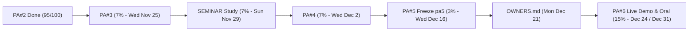
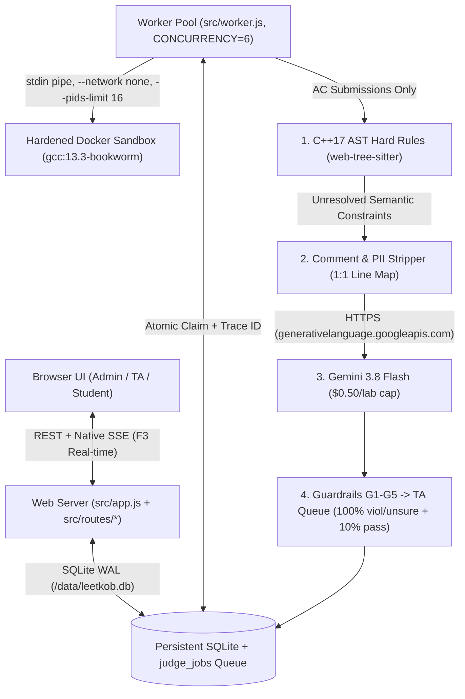

# LeeTKOB Master Implementation Plan (`PA#3` → `PA#6`)

**Course:** CSC13114 — Advanced Web Application Development · HK1 2026–2027  
**Remaining Course Weight:** **32% of total course mark** (`PA#3` 7% + `PA#4` 7% + `PA#5` 3% + `PA#6` 15%)  
**Repository:** `https://github.com/danhuupham/leetkob`  
**Team Members:**
- `20120450` — Phạm Hữu Đan (`20120450@student.hcmus.edu.vn`)
- `21120595` — Nguyễn Thành Vinh (`21120595@student.hcmus.edu.vn`)
- `23120256` — Trần Đại Hiệp (`23120256@student.hcmus.edu.vn`)

---

## 1. How to Execute These Plans (Even with a Smaller / Weaker AI Model)

Every task across `PA#3`–`PA#6` is specified as an **Agent-Executable Specification** (Session 2 methodology) so any team member using **any** AI model gets consistent, conflict-free results:

1. **Always include [`SHARED-CONTRACTS.md`](./SHARED-CONTRACTS.md) in context:** It locks down exact SQLite table/column names, JS function signatures, Gemini `v1beta` request payloads, RFC 9457 error slugs, and 12 Weak-Model Survival Rules.
2. **Copy-paste the task's prompt block (`T3.x` / `T4.x` / `T5.x`):** Each task lists exact **Allowed Files**, **Forbidden Files**, **Test-First `AC1..ACn` criteria**, and a ready-to-paste prompt.
3. **Verify before pushing:** Run `npm run format && npm run check && npm run e2e`, confirm `git diff main -- leetkob-eval/` is empty, and merge multi-commit TDD PRs with `gh pr merge --merge` (never `--squash`).

| Document | Purpose |
|---|---|
| **[`SHARED-CONTRACTS.md`](./SHARED-CONTRACTS.md)** | **Mandatory shared SQL schemas, JS function interfaces, HTTP error slugs & 12 anti-trap rules** |
| **[`PA3-Plan.md`](./PA3-Plan.md)** | `PA#3` (7% · **Wed Nov 25, 22:00**) — Tasks `T3.1`–`T3.6` with copy-paste prompts & `AC` tests |
| **[`PA4-Plan.md`](./PA4-Plan.md)** | `PA#4` (7% · **Wed Dec 2, 22:00**) — Tasks `T4.1`–`T4.5` (5 guardrail commits, CI eval gate, held-out, red-team) |
| **[`PA5-Plan.md`](./PA5-Plan.md)** | `PA#5` (3% · **Wed Dec 16, 22:00**) — Tasks `T5.1`–`T5.6` (SSE, appeals, observability, 80-user load test, `B5` diff) |
| **[`PA6-Plan.md`](./PA6-Plan.md)** | `PA#6` (15% · **`OWNERS.md` Dec 21** · **Oral Dec 24 & 31**) — 23-min live demo script & oral Areas A–D |

---

## 2. Semester Timeline & Critical Dependencies

- **8-Day Triple-Deadline Crunch (`Nov 25` → `Nov 29` → `Dec 2`):** `PA#3` builds the 1:1 line-preserving comment sanitizer (`src/checker/sanitize.js`) and modular guardrail functions (`src/checker/guardrails.js`) upfront so `PA#4` extends rather than rewrites them.
- **Model Sunset Protection:** `gemini-2.5-flash` sunsets on **December 1, 2026** (one day before `PA#4` is due). The entire repository is standardized on **`gemini-3.8-flash`** (`$0.75/1M` input, `$3.75/1M` output -> `~$0.147/lab`, `$0.50/lab` cap).
- **Continuous Deployment Window (`Nov 25` → `Dec 31`):** `PA#3` stays live for `PA#4` peer red-teaming; tag `pa5` (Dec 16) stays frozen through `PA#5` marking (`Dec 17–23`) and `PA#6` live defense (`Dec 24` / `Dec 31`), including `PA#6`'s `B5` resubmission diff feature (`Task T5.3`).

---

## 3. Unified System Architecture (`PA#2` → `PA#6`)

---

## 4. Team Task Assignment Matrix (`OWNERS.md` Alignment)

| Team Member | `PA#3` Tasks (Due Nov 25) | `PA#4` Tasks (Due Dec 2) | `PA#5` Tasks (Due Dec 16) |
|---|---|---|---|
| **`20120450` — Phạm Hữu Đan** | `T3.3` C++ AST Hard Rules (`5 SP`) `T3.4` Gemini 3.8 + First Limits (`3 SP`) | `T4.3` Custom Cases + CI `eval-gate` (`5 SP`) `T4.4` Held-Out + 3x Variance (`3 SP`) | `T5.2` Logs, Traces, Dashboard & Alert (`5 SP`) `T5.6` 7-Section Post-Mortem (`3 SP`) |
| **`21120595` — Nguyễn Thành Vinh** | `T3.1` SQLite WAL Queue & Worker (`3 SP`) `T3.6` Web Flow + HTTPS Deploy (`3 SP`) | `T4.2` Human Gate `10%` Sample (`3 SP`) `T4.5` Co-Lead Peer Red-Team (`2.5 SP`) | `T5.1` Real-Time SSE + Appeals (`5 SP`) `T5.5` `pa5` Release, Rollback & Video (`3 SP`) |
| **`23120256` — Trần Đại Hiệp** | `T3.2` Docker Sandbox + 9 Attacks (`5 SP`) `T3.5` Checker CLI + Custom Cases (`2 SP`) | `T4.1` 5 Guardrails (`G1`–`G5`, 5 commits) (`5 SP`) `T4.5` Co-Lead Peer Red-Team (`2.5 SP`) | `T5.3` `B5` Resubmission Diff (`3 SP`) `T5.4` 80-User Docker Load Test (`5 SP`) |
