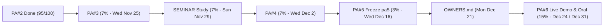
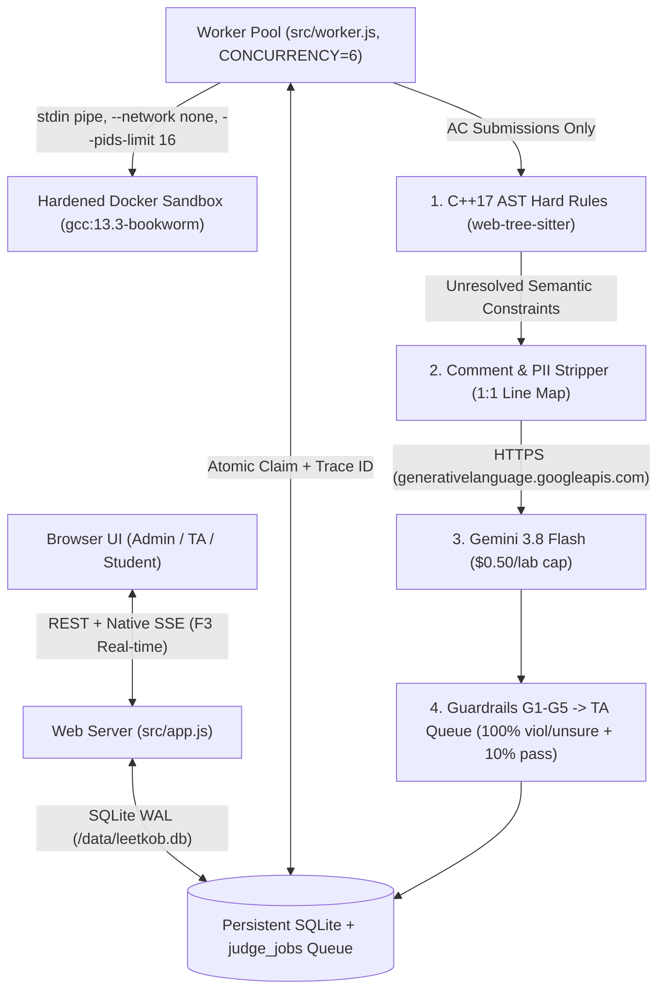

# LeeTKOB Master Implementation Plan (`PA#3` → `PA#6`)

**Course:** CSC13114 — Advanced Web Application Development · HK1 2026–2027  
**Remaining Course Weight:** **32% of total course mark** (`PA#3` 7% + `PA#4` 7% + `PA#5` 3% + `PA#6` 15%)  
**Repository:** `https://github.com/danhuupham/leetkob` (continuing from tag `pa2`)  
**Team Members:**
- `20120450` — Phạm Hữu Đan
- `21120595` — Nguyễn Thành Vinh
- `23120256` — Trần Đại Hiệp

---

## 1. Milestone Plans Index

All remaining milestone plans and reference specs live inside the repository (`docs/plans/`, `docs/reference/`, and `leetkob-eval/`):

| Milestone | Course Weight | Deadline (22:00) | Detailed Plan | Reference Docs |
|---|---|---|---|---|
| **PA#3** — Prototype with the LLM Feature Running | **7%** (100 pts) | **Wed, Nov 25, 2026** | [`PA3-Plan.md`](./PA3-Plan.md) | [`BRIEF.md`](../reference/BRIEF.md) · [`FAQ.md`](../reference/FAQ.md) · [`leetkob-eval`](../../leetkob-eval/README.md) |
| **PA#4** — Eval, Guardrails, Human Gate & Red-Team | **7%** (100 pts) | **Wed, Dec 2, 2026** | [`PA4-Plan.md`](./PA4-Plan.md) | [`BRIEF.md`](../reference/BRIEF.md) · [`FAQ.md`](../reference/FAQ.md) · [`leetkob-eval`](../../leetkob-eval/README.md) |
| **PA#5** — Final Build, Running and Observed | **3%** (100 pts) | **Wed, Dec 16, 2026** *(Uptime Dec 17–31)* | [`PA5-Plan.md`](./PA5-Plan.md) | [`BRIEF.md`](../reference/BRIEF.md) · [`FAQ.md`](../reference/FAQ.md) |
| **PA#6** — Final Demo and Individual Oral | **15%** (100 pts/member) | `OWNERS.md`: **Mon, Dec 21** · Oral: **Thu, Dec 24 & Dec 31** | [`PA6-Plan.md`](./PA6-Plan.md) | [`BRIEF.md`](../reference/BRIEF.md) · [`FAQ.md`](../reference/FAQ.md) |

---

## 2. Semester Timeline & Critical Dependencies

- **8-Day Triple-Deadline Crunch (`Nov 25` → `Nov 29` → `Dec 2`):** `PA#3` already builds the 1:1 line-preserving comment sanitizer (`src/checker/sanitize.js`) and modular guardrail hooks (`src/checker/guardrails.js`) so `PA#4` extends rather than rewrites them.
- **Continuous Deployment Window (`Nov 25` → `Dec 31`):**
  - `PA#3`'s public deployment is attacked by our assigned red-team peer during `PA#4` (`Nov 26–Dec 2`).
  - `PA#5`'s commit tagged `pa5` (`Dec 16`) must stay online without post-deadline code drift across both the `PA#5` marking window (`Dec 17–23`) and our `PA#6` live oral slot (`Dec 24` or `Dec 31`).
- **`PA#6` Feature Freeze Rule (`B5` Built in `PA#5`):** Because `PA#6` evaluates the exact `pa5` tag with zero new code allowed after December 16, our **Beyond-the-Brief (`B5` — 4/40 build pts)** feature (Side-by-Side C++ Resubmission Diff & Verdict Delta Viewer + automated tests) is scheduled inside [`PA5-Plan.md`](./PA5-Plan.md) before tagging `pa5`.

---

## 3. Unified System Architecture (`PA#2` → `PA#6`)

Continuing the `PA#2` harness (`Node.js >= 22.13`, ESM, `node:http`, `node:sqlite`, RFC 9457 `application/problem+json`) with minimal moving parts:

| Architectural Decision | Choice | Oral Defense Justification (`PA#6` Area B) |
|---|---|---|
| **Queue & Persistence** | Persistent SQLite (`WAL` mode, `busy_timeout = 5000`) + durable `judge_jobs` table + `UNIQUE(submission_id, constraint_id)` | Atomic enqueue with submission creation; guarantees `Q1` (judged & stored once across worker restarts) and absorbs 80 burst submissions in `< 150ms` without Redis/RabbitMQ operational overhead. |
| **C++ Judge Sandbox** | Custom hardened Docker image (`gcc:13.3-bookworm` pinned by digest) + host wall-clock `docker rm -f` container kill | Saves ~1.8 GB idle RAM vs. Judge0's 4-container Ruby/Postgres/Redis stack on a small VPS while enforcing all 9 minimums (`M1`–`M9`), verified by 9 CI attack `.cpp` tests. |
| **Hard Rules (`D1`)** | `web-tree-sitter` + `tree-sitter-cpp.wasm` AST analyzer | Zero native C++ addon build failures across Windows/Linux/Docker; immune to comments, string literals, custom `my_ns::sort`, and `#include <algorithm>` for `std::swap`. |
| **Real-Time Status (`F3`)** | Native HTTP Server-Sent Events (`text/event-stream`) | Unidirectional judge status push (`queued -> compiling -> running -> AC`) in ~35 lines of standard `node:http` with automatic browser reconnection and zero WebSocket library bloat. |
| **Hosting Infrastructure** | Always-on Linux VPS with Docker Engine + Caddy automatic HTTPS | Supports nested `docker run --network none --pids-limit 16` sandboxes, persistent `/data` volume across releases/rollbacks, and zero cold-start sleep during marking. |

---

## 4. Balanced Team Ownership Matrix (`OWNERS.md` Trajectory)

In `PA#6`, examiners select individual oral questions from `OWNERS.md` and `git log --author`. Every member commits their owned modules under their own Git identity from `PA#3` onward:

| Team Member | Primary Owned Subsystems (`PA#3`–`PA#5`) | Story Points (`PA#3` / `PA#4` / `PA#5`) |
|---|---|---|
| **`20120450` — Phạm Hữu Đan** | C++ AST hard rules (`F5`), comment/PII sanitizer & Gemini 3.8 Flash client (`F6`), CI `eval-gate` & held-out calibration (`F10`), structured logs/metrics/traces & incident post-mortem (`F11`) | `8 SP` / `8 SP` / `8 SP` |
| **`21120595` — Nguyễn Thành Vinh** | Accounts/classes/labs (`F1`, `F2`), SQLite WAL queue & worker (`F3`, `Q1`), human gate `10% pass` sampling & Publish contract (`F8`), real-time SSE & appeals (`F9`), HTTPS release/rollback | `6 SP` / `5.5 SP` / `8 SP` |
| **`23120256` — Trần Đại Hiệp** | Hardened Docker sandbox & 9 attack suites `M1`–`M9` (`F4`), 5 model guardrails `G1`–`G5` (`F7`), dataset CLI checker & `Dockerfile.checker` (`F10`), 80-student load test (`load/`), Beyond-the-Brief diff (`B5`) | `7 SP` / `7.5 SP` / `8 SP` |

---

## 5. High-Severity Rubric Pitfalls & Automated Safeguards

| Milestone | Critical Rubric Penalty | Automated / Process Guardrail |
|---|---|---|
| **PA#3** | **Syllabus Rule (0 pts across Criteria 4, 5, 6 = −40 pts):** Model verdict affects student mark without TA Publish, or model output lacks schema check / timeout. | Student endpoints physically omit `constraint_verdicts` while `published_at IS NULL` (`FAQ-08`); `llm-client.js` enforces `AbortSignal.timeout` + `checkSchema` on every call. |
| **PA#3 & PA#4** | **Mutating `eval.mjs` (`c836edd8...`), `labels.jsonl` (`262cda7b...`), or dev `.cpp` files:** 0 pts on Eval criteria. | `scripts/verify-eval-integrity.js` runs inside `npm run check` on every commit/PR, plus `.github/CODEOWNERS` protection. |
| **PA#3 & PA#4** | **Tests committed after code, loosened tests, or squashed/rewritten commit history:** Loses TDD/commit points. | Strict 1-part-per-PR workflow with failing/offline tests committed before or alongside `src/`, never rebasing timestamps after completion. |
| **PA#4** | **Missing `marking.env` attachment (held-out runs `MODEL_OFF=1`) or committing `marking.env` to Git:** Loses 10–20 pts. | Add `marking.env` to `.gitignore` + `scripts/scan-secrets.js`; attach scoped `$5`-capped `marking.env` beside the zip on Classroom. |
| **PA#5** | **API key or student name/ID leaked in readable logs:** Criterion 3 capped at `4/20` (−16 pts). | Mandatory `redactSensitive()` filter in `src/obs/logger.js` + automated log-leak assertion test in `npm run check`. Keep `ACCESS.md` gitignored inside zip only. |
| **PA#6** | **Deploying post-`pa5` fixes or leaving AI tools open during oral defense.** | Lock production to tag `pa5` on Dec 16; run full 23-minute mock defense on Dec 22 with all AI assistants quit. |
